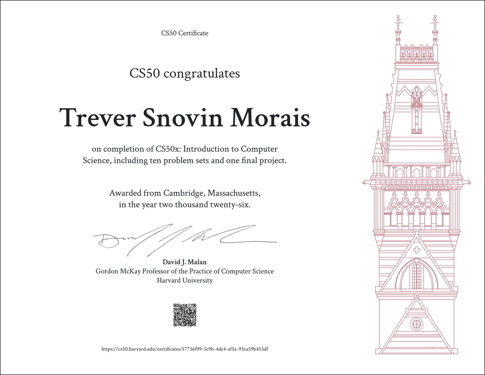

# Hey, I'm Trever,

An ECE undergrad drawn to the point where software meets hardware: firmware, embedded systems, and the silicon underneath the code. CS50 graduate, building something new every month and still chasing that “wait, that’s how it works?” feeling.

 

[Achievements](#achievements) &nbsp;·&nbsp; [Exploring](#what-im-exploring) &nbsp;·&nbsp; [Headed](#where-im-headed) &nbsp;·&nbsp; [Projects](#things-ive-built) &nbsp;·&nbsp; [Skills](#what-i-work-with) &nbsp;·&nbsp; [Connect](#connect)

---

## Achievements

### CS50

  

---

## What I'm exploring...

- Embedded systems and Microcontrollers
- VLSI & Semiconductor design technology
- Training my own AI and NCM models
- Publishing my Websites and Indie Games

## Where I'm headed...

> Long term, I want to be doing serious hardware-adjacent engineering — the kind of work happening at places like Qualcomm, Texas Instruments, Intel, NVIDIA, Bosch, and ISRO. Getting there one project at a time.

---

## Things I've built...

### Browser-based projects...

**Loose Ends** — a 2D ragdoll archery duel game. HTML5 Canvas + vanilla JS with Verlet-integration physics. Runs fully offline as an installable PWA (progress saved on-device), and wrapped with Capacitor for Android. Live on GitHub Pages; store release in progress. Play it.

**PennyLog** — a personal expense tracker. Flask + SQLite with user accounts. Imports Paytm and bank statements (CSV/Excel), syncs transaction alerts from Gmail over read-only IMAP (app password stored with Fernet encryption), and turns it all into budgets, spending insights and recurring-payment detection. Covered by an automated test suite.

### AI projects...

**Seraphine-AI** — a GPT-style language model built from scratch in PyTorch: byte-level BPE tokenizer, decoder-only transformer (causal multi-head attention, pre-LayerNorm, weight tying), AdamW with warm-up + cosine schedule, and top-k / top-p sampling. Trained purely on conversations distilled from a local Ollama model.

**MiniNCM** — a small Next-Concept Model chatbot, my scaled-down take on the Next-Concept Modeling paper. A multiscale residual VQ tokenizer plus a generator that writes a whole coarse-to-fine level per forward pass (4 passes for 64 characters instead of 64). Ollama acts as the teacher that writes the training data.

### C and Python projects...

**Speller** — a spell-checker in C using a hash table for fast lookup, loading a 140k+ word dictionary into memory and checking a document against it word-by-word.

**Caesar / Substitution** — command-line cryptography tools in C, encrypting text with classic Caesar-shift and general substitution ciphers, including full key validation.

**Runoff / Tideman** — Python implementations of ranked-choice and Condorcet-method voting algorithms, handling preference tallying and cycle detection.

**DNA** — a Python tool that identifies a person from a DNA sample by matching Short Tandem Repeat counts against a CSV database — the same technique used in real forensic analysis.

**Hamming Code** — My first ECE-centric program targeting a critical part of electronics: error correction, a C command-line tool that encodes 4 data bits into a 7-bit Hamming codeword and detects and corrects any single-bit error using the parity-bit syndrome, with a written walkthrough of the maths.

### Scratch

My first CS50 project, built in Scratch before moving to C — an arcade-style basketball game.
The `scratch-project.sb3` file is in this repo as a downloadable artifact — download it and open in the [Scratch desktop editor](https://scratch.mit.edu/download) or drag it into a project on [scratch.mit.edu](https://scratch.mit.edu) to run it.

Download: [scratch-project.sb3](./scratch-project.sb3)

---

## What I work with...

#### Languages

- **Python** — CS50 problem sets, a text-to-video CLI tool, Flask back ends, and machine-learning projects in PyTorch
- **C** — CS50 problem sets (Weeks 0–5) built close to the hardware: manual memory management, hash tables, ciphers, and bit-level error correction
- **JavaScript** — front-end and game logic in vanilla JS, with no framework
- **SQL** — queries and schema design, from CS50's cs50.SQL to plain SQLite

#### Web and apps

- **Flask** — back ends for my browser-based projects: user accounts, sessions, and data import
- **HTML5 Canvas** — real-time game rendering and physics for Loose Ends
- **SQLite** — persistence for accounts, progress, and transaction data
- **PWA and Capacitor** — packaging web apps for offline use and for app-store release

#### AI and tooling

- **PyTorch** — language models like Seraphine-AI and MiniNCM, built on the same core architecture as the big models.
- **Git and GitHub** — version control and project hosting, with GitHub Pages for deployment

---

## Connect

[Mewral Art / portfolio] · trevercommercial@gmail.com · treversnovin@gmail.com

## Fun fact

In my free hours I play keyboard, sketch, watch TV shows and vibe code projects. 
I have my own brand / design entity, **Mewral Art**, where I make and post eye-catching art and scenery.
